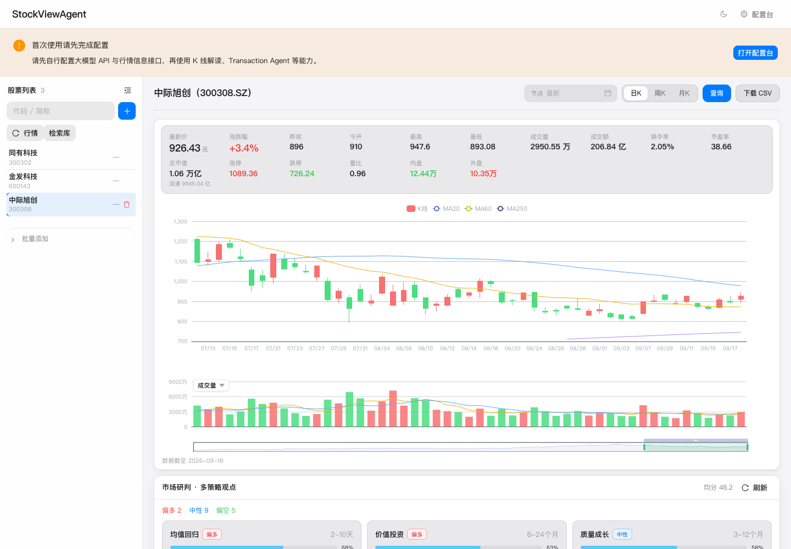
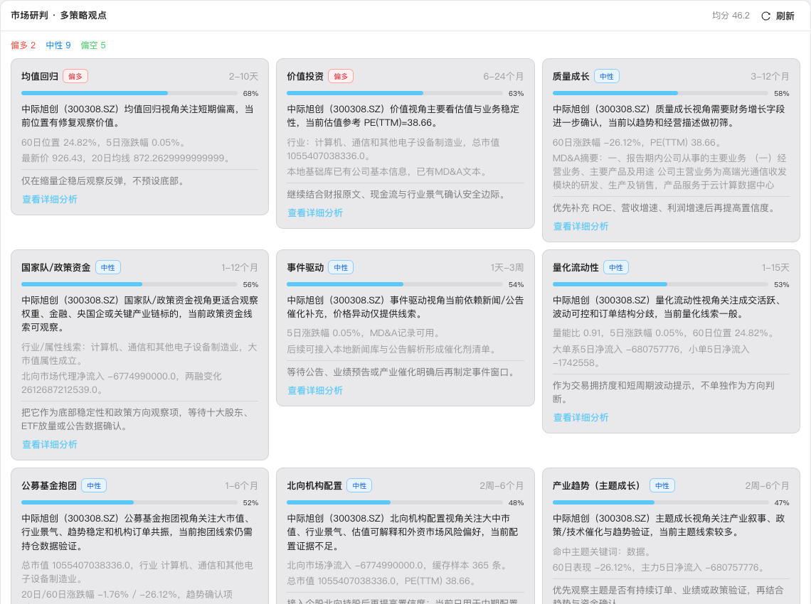
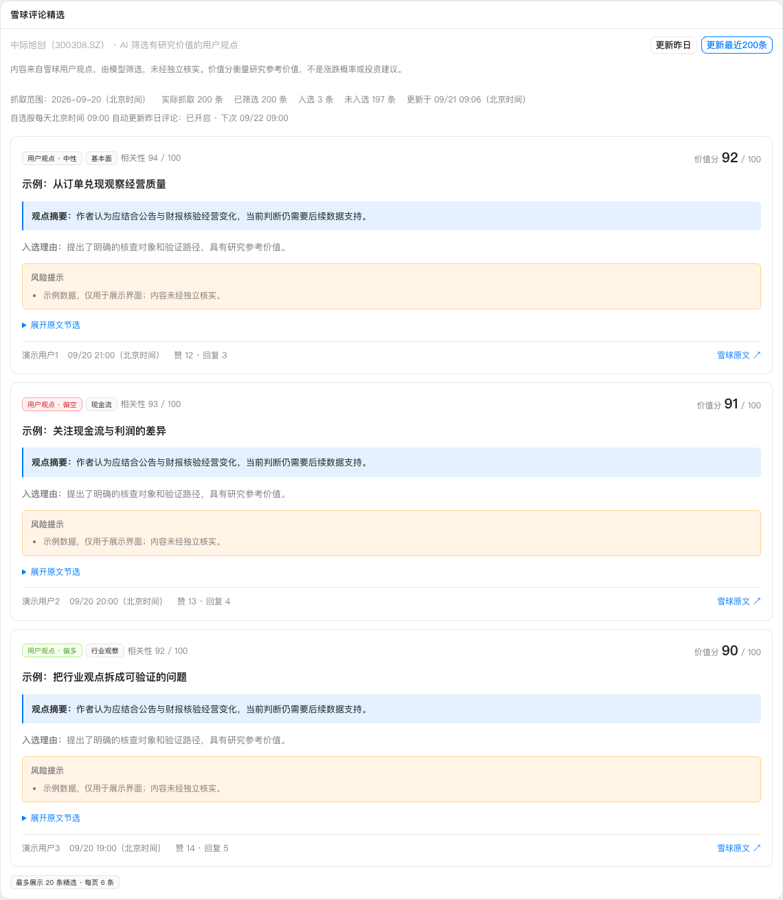

# StockViewAgent

本地运行的 A 股研究工作台。围绕个股与股票列表，把行情、新闻、财报、研究档案、持续监控和历史复盘放在一起，支持配置自己的大模型接口，持续积累资料与判断记录。

## 近期更新

- **研究与监控**：新增私人研究档案、问题与材料管理，支持将研究中的观察项建立为监控计划，再把监控变化带回研究。
- **K 线与复盘**：统一个股、市场研判和历史回放的指标设置，新增 BOLL、MACD、KDJ、RSI 参数调整及最多 3 个联动副图。
- **宏观与资讯**：整合 ExStockNEWS 2.0 的市场研判功能，新增中美美林时钟、跨资产历史比较和海外财经快讯归档。
- **财报季**：查找正式财报、下载 PDF、按页提取文字，围绕用户问题生成带页码引用的解读。
- **后台采集**：支持每日定时、分批续跑、来源切换、失败退避和资源阈值，页面刷新与后台计划分开设置。
- **页面整理**：精简重复介绍、按钮与空栏目，统一操作和状态名称，优化桌面与手机端呈现。

## 功能入口

| 入口 | 可以做什么 |
|---|---|
| **关注个股** `/` | 管理股票列表，查看行情、技术指标、多策略观点、新闻财报、公司资料与当前研究 |
| **研究** `/research` | 建立个股、股票列表或主题档案，整理问题、材料与历次研究报告 |
| **监控** `/monitor` | 自定义观察条件、检查频率与复盘日期，处理变化提醒和复盘决定 |
| **K线复盘** `/replay` | 回放历史行情，逐日记录判断，导出复盘笔记 |
| **美林时钟** `/merrill-clock` | 查看中美增长／通胀周期，比较跨资产历史曲线 |
| **工具 → 今日变化** `/today` | 汇总自选股新增资料、修订和到期复盘 |
| **工具 → 市场研判** `/macro` | 查看大盘、宏观、行业和资金，生成 K 线解读 |
| **工具 → 海外快讯** `/news` | 筛选、搜索海外财经新闻，查看原文与来源状态 |
| **工具 → 经济日历** `/calendar` | 跟踪重要经济事件，为研究检索配置事件范围 |
| **工具 → 量化实验室** `/lab` | 比较候选策略、回测实验、前向观察与模拟账户 |
| **工具 → 数据中心** `/data` | 管理自动采集、任务、文件、缓存和回收区 |
| **设置** `/setup` | 配置模型与行情连接，查看运行日志和用量 |

## 从关注到研究、监控与复盘

1. **关注个股**：搜索或批量添加股票，结合行情、财报和新闻确定要研究的问题。
2. **建立研究**：保存自己的判断，补充笔记、TXT／Markdown／PDF 和待回答问题，手动生成并选择采用研究报告。
3. **持续监控**：把下一步观察带入计划，确认对象、条件、资料来源、检查频率和复盘日期后启用。
4. **处理变化**：查看触发原因与证据，记录继续、修改或结束观察；需要进一步研究时，将本次变化导回档案。

研究和监控以个股、最多 20 只股票的固定列表为主，也支持主题；监控另支持主要大盘指数。个人判断、已采用报告和历史版本分别保存。浏览、编辑、上传和采用报告不调用模型；生成研究需要配置模型，启用监控还需验证连接。详见 [研究工作台](docs/INVESTMENT_WORKSPACE.md) 与 [观察、监控和复盘](docs/OBSERVATION_MONITORING.md)。

### 观察计划与变化提醒

按每小时、每 6 小时或每天检查已采集的新闻、行情、技术指标、策略观点、公司公告和论坛讨论。用户可设置观察目标、触发条件、失效条件和复盘日期，暂停单个计划或整个账户。

证据未变化时复用已有报告；结论、条件或资料变化、到期复盘及首次失败产生站内提醒。报告保留逐股结论、引用、资料缺口和当时的计划。已读、处理决定与人工复盘分别记录，便于回看每次判断为何改变。

### 今日变化与关注判断

今日变化集中展示自选股的新资料、新闻修订、主动关联的经济事件和到期复盘，支持标记已读、有用或无关。首次扫描建立基线，之后持续记录变化。

从多策略观点或新闻解读保存关注判断，记录理由、观察条件、证伪条件和复盘日期。后续资料可关联为证据，由用户确认支持、反证或暂无法判断；修改和结束跟踪后仍保留历史。后台在北京时间 16:30 后扫描本地资料，也可手动刷新。

## 行情、指标与历史回放

### 个股行情与公司资料

股票列表支持搜索和批量添加；选中股票后查看日／周／月 K 线、行情指标、公司简介、主营业务、公告和新闻。个股页同时展示关联研究与监控，财务图表读取本地导入的历史记录，保留原字段、报告期、来源和单位。

**下方截图为页面示例，部分来自早期版本，可点击放大；雪球评论图使用演示数据。**

[](docs/images/overview.png)

### 技术指标设置

个股、市场研判和 K 线复盘共用指标计算与呈现方式。加载行情、切换周期或修改参数后自动重算。

| 显示区域 | 设置 |
|---|---|
| 主图 | 分别开启或关闭 MA 均线、BOLL 布林线，可同时显示 |
| 副图 | 从成交量、MACD、KDJ、RSI 等指标中最多选择 3 个，时间轴与缩放联动 |
| 参数 | MA 周期；BOLL 周期和标准差倍数；MACD 快、慢、信号周期；KDJ 窗口和平滑周期；RSI 周期 |
| 偏好 | 按账户和页面类别保存在当前浏览器，支持恢复默认 |

指标使用已加载行情在本地计算，无需模型；历史不足的区间留空。默认参数与计算方法见 [K 线指标设置](docs/KLINE_INDICATORS.md)。

### K 线复盘与盘感练习

选择股票、历史区间和起点，逐个交易日推进或自动播放，也可后退、定位日期和拖动进度。日／周／月 K 线及指标只使用截至当前回放日的数据。

每个节点可记录看多、看空或观察的判断与理由，并导出已看到的笔记。笔记按账户和股票保存在当前浏览器。市值、PE、TTM 盈利等按历史来源覆盖显示，缺失留空。详见 [K 线复盘](docs/KLINE_REPLAY.md)。

### 多策略观点

并列查看价值投资、质量成长、均值回归、事件驱动等研究视角，比较方向、观察周期、依据和风险，展开详细分析或指定历史日期生成观点。需要持续验证的观点可保存为关注判断。

[](docs/images/strategies.png)

## 新闻、财报与讨论

### 个股新闻与财报季

个股新闻按时间或重要性整理，保留原文入口，支持更新新闻和解读待处理内容。

在 **新闻与财报 → 财报季** 查找年报、半年报、一季报和三季报。优先读取巨潮资讯，必要时转向东方财富，下载原始 PDF 并按物理页提取文字。填写关注问题后，生成营收利润、现金流、利润质量、资产负债、业务分部、同比比较、审计风险及后续观察的解读。

每份结果保留页码引用、实际阅读范围、资料缺口和历史版本；相同文件、问题与模型配置可复用已有结果。查找和解析不调用模型，解读由用户手动提交；扫描 PDF 暂不支持 OCR。详见 [财报季解读](docs/EARNINGS_REPORTS.md)。

### 海外财经快讯

聚合 Reuters、Bloomberg、Benzinga、WSJ、FT、CNBC 的标题、公开摘要与原文入口，支持来源筛选、关键词搜索和分页。来源状态展示实际地址、最后成功时间、内容时效及重试状态，新闻归档可供个股关联和解读使用。

公开 RSS 和新闻索引存在延迟，**不是付费终端实时流**。Benzinga 支持配置授权 News API。后台维护可用来源地址，在连接故障时切换已配置线路；拒绝访问与限流进入冷却，公网出口由实际网络或代理决定。详见 [海外新闻聚合](docs/OVERSEAS_NEWS.md)。

### 雪球评论精选

从最近 200 条个股讨论中筛选最多 20 条，展示观点摘要、入选理由、风险提示和原文链接。支持手动更新最近或昨日讨论；启用定时更新后，每天北京时间 09:00 整理关注股票前一天的讨论。需要可用的模型和雪球连接，登录或验证状态可在设置中处理。

[](docs/images/xueqiu-comments-demo.png)

## 市场研判、美林时钟与经济日历

### 市场研判 · ExStockNEWS 2.0 功能整合

整合大盘指数、宏观与行业、资金概览和 K 线解读四组功能：

- **大盘指数**：上证、深成、创业板、沪深 300、上证 50，支持日／周／月 K、区间选择和技术指标。
- **宏观与行业**：黄金、离岸人民币、布伦特原油、申万行业，按 Tushare 账户权限读取。
- **资金概览**：行业资金、机构与情绪代理指标、北向和两融历史、热门榜单、ETF 及个股资金流。
- **K 线解读**：手动生成大盘分析、单次问答或个股策略观点，可补充参考资料。

公开指数默认每小时更新并归档，空列表或关闭页面时仍可采集；来源失败保留上次有效行情及日期。详见 [市场研判](docs/MARKET_WORKSPACE.md)。

### 美林时钟

提供中国、美国两套增长／通胀周期时钟，结合宏观指标展示复苏、过热、滞胀、衰退及过渡状态。可比较 20 条股票、债券、商品、汇率与现金相关周度序列，选择资产、时间范围、基准 100 归一化、原值或区间回撤。

后台每周六北京时间 08:00 更新，账户可开启每周模型解读。回溯目标为 50 年，实际历史长度、ETF 代理和收益率口径在覆盖表中显示。详见 [美林时钟](docs/MERRILL_CLOCK.md)。

### 经济事件日历与检索

按月份、地区、类别和重要性查看央行会议、通胀、就业、经济增长等日程，保留来源、采集状态与修订记录。内置美联储、欧洲央行、日本央行、中国统计局和美国劳工统计局官方日历；来源未提供的实际值、预期与前值留空。

在 **Agent 事件检索** 设置地区、重要性、回看／前瞻窗口和条数，让相关新闻、多策略、量化研究、K 线与市场研判读取已保存事件。历史分析按当时已采集的版本检索。详见 [经济事件日历](docs/GLOBAL_EVENTS.md)。

## 量化实验室

集中查看数据积累、候选策略、实验比较、前向观察和模拟账户。独立 worker 在设定预算内生成受限策略规则、回测、记录失败原因，并从固定 GitHub 来源学习研究方法。

通过历史验证的策略进入前向观察，满足证据条件后可替换模拟策略，并保留回滚记录。自动晋升要求完整的历史交易状态与时点证据，以及至少 60 个前向交易日；普通行情缓存仍可用于探索。该模块提供研究和模拟，不执行实盘交易。详见 [研究实验室](docs/RESEARCH_LAB.md)。

## 自动采集与资源管理

**后台计划决定何时取数，页面设置决定如何显示。** 后端保持运行时，关闭浏览器不影响采集；停止服务或电脑休眠后暂停，恢复运行后续跑。

| 设置位置 | 管理内容 |
|---|---|
| 数据中心 → 后台自动采集配置 | 股票池、来源开关、每日时间／间隔、批大小、任务预算、并发、内存与磁盘阈值；海外采集开关和间隔 |
| 页面显示设置 | 本浏览器的页面刷新间隔；海外快讯默认每 15 秒读取本地归档，页面隐藏时停止轮询 |
| 各模型功能与研究预算 | 研究提交、监控频率、每周解读和量化任务的模型用量 |
| 数据中心 → 磁盘缓存与回收 | 缓存期限、清理预览、回收、恢复和永久删除 |

中央采集覆盖 **12 类任务**：大盘指数、个股行情、新闻、公司资料、资金流、经济日历，以及欧洲央行参考汇率、世界银行三类年度指标、美联储政策公告和欧洲央行公告。新安装的个股行情、公司资料、资金流默认北京时间每天 17:30 更新；海外来源默认每 120 秒轮询。已保存的调度配置在升级后继续沿用。

为控制后台开销，默认每批 10 只股票、每类采集器单并发；保存进度、分批写入，失败退避，重启后继续未完成任务。当前 API 进程内存达到默认 768 MiB 软阈值，或剩余磁盘低于 1 GiB 时暂缓新任务。资源恢复后继续，失败不会清空已有成功资料。

管理员可查看文件分类、数据版本、来源状态和任务进度。缓存先预览再移入可恢复回收区；自动回收默认关闭，研究证据、数据库、上传原件和账户配置长期保留。公共资料可进入本地全文检索，供研究引用。详见 [数据中心与自动采集](docs/DATA_CENTER.md)。

## 开始使用

准备 **Python 3.11–3.13、Node.js 20+（含 npm）和 Git**，执行：

```bash
git clone https://github.com/fxfxfx99/StockViewAgent.git
cd StockViewAgent
./start.sh
```

脚本准备项目依赖，启动后端、前端和研究 worker，就绪后打开 [本地工作台](http://127.0.0.1:5175/)。默认前端端口为 `5175`，后端为 `8001`；支持 macOS／Linux，Windows 可使用 WSL2 或 Docker。

在 **设置 → 连接与数据** 选择模型供应商并填写 API Key，自定义接口补充 API Base 和模型名。**保存并开启量化自动研究** 会同时启用量化调度，可在量化实验室暂停或调整预算；研究、监控、财报等功能保留各自的提交方式与额度。公开行情和公共资料采集无需模型，KlineShare、Tushare 等账户可在高级设置中选配。

新账户初始化 5 只示例自选，已有列表保持不变。**设置 → 运行日志** 可查看状态、模型调用、Token 与采集记录。监督器尝试恢复意外退出的服务；停止或电脑重启后再次运行 `./start.sh`。

```bash
./start.sh --status      # 查看运行状态
./start.sh --no-browser  # 启动但不自动打开浏览器
```

详细安装、Docker、端口配置和常见问题见 [本机启动说明](docs/LOCAL_SETUP.md)。

## 数据保存与搬迁

服务端数据默认存入 `backend/data/`：行情、新闻、财报原件、私人研究档案、监控计划、判断历史、账户配置与运行日志。研究、监控和个人模型报告按账户保存；K 线显示偏好及复盘笔记保存在当前浏览器。

可通过 `STOCKVIEW_DATA_DIR` 指定其他目录。在 **设置 → 连接与数据 → 高级设置** 查看实际位置和大小；停服务后使用 `scripts/storage.py migrate` 校验复制，原目录保留。迁移包含已保存的账户与 API 配置，外置 `.env` 和环境变量另行配置。详见 [本地数据目录与搬迁](docs/LOCAL_SETUP.md#本地数据目录与搬迁)。

## 开源学习与致谢

感谢开源社区，以及以下项目的作者、贡献者与维护者。StockViewAgent 在开发中学习了这些项目的实现与设计，并将部分项目文档纳入研究实验室的固定学习来源：

| 参考项目 | 学习或使用内容 | 使用方式 |
|---|---|---|
| [CNEquity](https://github.com/rootSunc/CNEquity) | 不可变数据批次、行级溯源与历史时点查询；本项目补充逐行批次标识，修正修订合并前的可见性筛选 | 设计参考、自行实现；查询指南纳入文档学习来源 |
| [MyTT](https://github.com/mpquant/MyTT) | 均线、MACD、RSI 等技术指标函数 | 直接引入指标库代码，保留文件内原作者与来源声明 |
| [Ashare](https://github.com/mpquant/Ashare) | 新浪、腾讯公开行情接口的 URL 与参数组织 | 行情适配实现参考 |
| [daily_stock_analysis](https://github.com/ZhuLinsen/daily_stock_analysis) | 股票代码规范化、Excel 导入列名识别与大小限制、统一错误响应 | 实现思路参考 |
| [agent-quantspace](https://github.com/quantskills/agent-quantspace) | 信号与目标权重、回测、报告的职责拆分 | 回测模块设计参考 |
| [OSkhQuant](https://github.com/khscience/OSkhQuant) | A 股交易成本、滑点、T+1 与风险约束 | 公开源码设计参考；上游声明 CC BY-NC 4.0 |
| [Microsoft Qlib](https://github.com/microsoft/qlib) | 实验参数、指标与产物的可追溯记录 | 研究文档学习来源 |
| [Microsoft RD-Agent](https://github.com/microsoft/RD-Agent) | 假设、验证、反馈与修订循环 | 研究文档学习来源 |
| [Freqtrade](https://github.com/freqtrade/freqtrade) | 截断数据重算与前视偏差检查 | 研究文档学习来源 |
| [VeighNa / vn.py](https://github.com/vnpy/vnpy) | 数据、策略与研究分层 | 研究文档学习来源 |

文档学习会在成功获取资料后记录文件、commit、内容哈希与引用链接；配置了来源不表示已经取得资料，也不代表移植了对应框架。CNEquity 本轮参考版本、具体落地与边界见 [学习记录](docs/RESEARCH_LAB.md#cnequity-的学习与落地)。

同时感谢 FastAPI、React、Ant Design、Apache ECharts、LiteLLM、NumPy、pandas、DuckDB、Apache Arrow、BaoStock、Pytdx 等开源基础库和工具。第三方代码、文档与数据各自遵循其原有许可证或使用条款，本项目的 [MIT 许可证](LICENSE) 不替代第三方授权；后续引入或借鉴其它项目时，也会补充来源与致谢。

## 文档与参与开发

- [数据来源](docs/DATA_SOURCES.md) · [雪球讨论与定时更新](backend/docs/XUEQIU_OPTIONAL.md#雪球评论精选)
- [分享给他人试用](docs/PUBLIC_TRIAL.md) · [参与开发](CONTRIBUTING.md) · [MIT 许可证](LICENSE)
